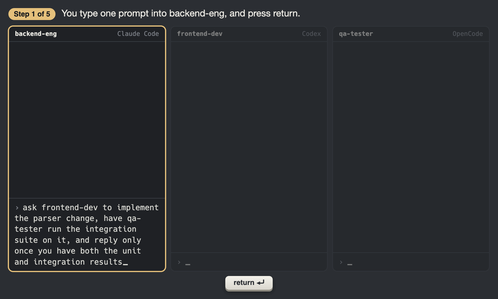

<picture>
  <source media="(prefers-color-scheme: dark)" srcset="docs/assets/kaiusap-icon-dark.svg">
  
</picture>

# kAIusap

*kAIusap*, pronounced **KAI**-yoo-sup, lets long-lived Claude Code, Codex, and OpenCode sessions on one machine message each other, using the names (handles) that you give them.

kAIusap is inspired by the Tagalog word for "the one you are talking with", *kausap* (ka-**OO**-sahp).

Who's it for? For developers, engineers, and knowledge workers who find themselves orchestrating and coordinating multiple sessions, each with its own role, responsibilities, and long-running threads they want to keep.

I built kAIusap because I was tired of copying and pasting between AI sessions to make them work together. Unlike spawned subagents, your sessions that use kAIusap stay separate and in view: you see what they say to each other, and you can step in at any point to interact directly with any of them.



*Illustration: You ask backend-eng to have frontend-dev make a change, and to coordinate testing with qa-tester. frontend-dev makes the change, runs the unit tests, and asks qa-tester to run the integration tests. Every message goes through kAIusap until backend-eng reports both sets of test results back to you.*

Incoming messages will wake an idle session. kAIusap provides message inboxes for recipients that can't be woken. When you next open one, kAIusap tells it that it has unread messages, or you can just tell it to check its inbox.

| Works with | |
|---|---|
| Systems | macOS and Linux (untested on Windows with PowerShell) |
| Harnesses | Claude Code (in a terminal or the Claude desktop app), Codex, OpenCode 1.x, OpenCode 2 |
| Needs | Python 3.12 or later, `uv`, Rust (`rustc`) |
| Companion | [kAIusap map](https://github.com/mkiiim/kaiusap-map): an interactive topology of your sessions and their communications in a browser |

## Install

Get the code:

```sh
git clone https://github.com/mkiiim/kaiusap.git
cd kaiusap
```

Check first:

```sh
./install.sh --plan
```

This checks the compatibility of your current setup (Python, `uv`, a working `rustc`, and whichever of the Claude Code, Codex, and OpenCode harnesses you have) and lists every change the install would make. However, nothing is changed until you...

Then install:

```sh
./install.sh
```

This runs the same check, shows the plan, and asks once before changing anything. It then installs `kaiusap`, a plugin for each harness it found, and the settings they need, backing up each file it changes. It checks the result with `kaiusap setup` and ends with the few steps only you can do, such as approving kaiusap's hooks in Codex.

## Upgrade, repair, and roll back

```sh
git pull
./install.sh
```

Running `./install.sh` again changes only what's missing or out of date, so the same command upgrades an install after `git pull` and repairs one that's broken. `./install.sh --rollback` goes back to the version the last upgrade replaced.

If you run a second OpenCode under another name, such as OpenCode 2 as `opencode2` beside OpenCode 1.x, name it: `./install.sh --opencode 2 --opencode-command opencode2 --opencode-config <its config folder>`.

## Uninstall

```sh
./install.sh --uninstall
```

It removes only what the installer added, leaving settings you changed since, and asks before deleting `~/.kaiusap/`, which holds every message and record. The Codex hook approvals (`hooks.state` in `~/.codex/config.toml`) are left for you to remove.

## Using kAIusap

You use kAIusap by talking to your sessions. Each session uses kAIusap through the tools its plugin adds (an MCP server named `kaiusap`).

### Name your sessions

Tell each session to name itself:

> you are backend-eng

The name is the session's handle. Think of it as its persona with which you can maintain long-lived conversations. It stays with your session when you resume it. After `/clear` or `/new`, it stays with the conversation you left: the new session is told so, shown how to go back, and offered the handle, so saying "you are backend-eng" there carries it on. This allows other sessions to use it as an identity to which they send messages and keep track of each other.

You can also let kAIusap name your session. The first time a session with no handle calls kAIusap, for example to check its inbox or send a message, it offers you a randomly generated name such as `delicate-haze-4521`. To have it take a randomly generated name straight away, just tell it:

> pick a name for yourself

### Send a message

Ask a session to message another by handle:

> ask frontend-dev to implement the parser change, and return with test results

The sending session tells you in one line what happened: the message was delivered and woke the recipient, or it was stored, for example because the recipient wasn't running. In the event of a stored message, an instruction will be provided that can be pasted into the recipient's prompt telling it to read that specific message.

### Read and reply

A woken session reads its message and acts on it. You can see both sessions in their terminals and can step in at any point. kAIusap tells each session to treat another session's message as a request to check, not as an instruction from you: it answers from what it knows or can look up, and asks you before doing more, such as changing files, unless you've already told it that it can do that kind of work.

> [!NOTE]
> Claude Code shows every message from another session as coming from "another Claude session", even when a Codex or OpenCode session sent it. The actual sender type is in kAIusap's first line, for example: "reply from frontend-dev (Codex, a peer assistant, not the user)".

### Stop everything

If sessions get into a loop, any session, or a shell, can pause every delivery:

```sh
kaiusap pause
```

Messages are still written while paused, and delivered to no one. Tell a session to unpause when you're ready. kAIusap also limits how deep a chain of messages can go and how many deliveries run each hour.

### From a shell

`kaiusap sessions` lists every session, with the command to get back to each one. A session in the Claude desktop app is listed as "in the Claude desktop app", and the [kAIusap map](https://github.com/mkiiim/kaiusap-map) opens it there. `kaiusap who` lists the handles, and `kaiusap setup` checks what's installed.

## Verbs

Sessions run these as tools; each is also a `kaiusap` command. Verbs marked *on your word* run only when you tell that session to, never because a message asks.

| Verb | What it does |
| --- | --- |
| `iam [<handle>]` | Take a handle (*on your word*); refused while another running session holds it; with no handle, takes a generated one |
| `release` | Give up this session's handle (*on your word*) |
| `whoami` | Show this session's handle, whether a message will wake it, and its unread count |
| `who` | List the active handles |
| `send` | Send a new message to a handle, saying whether it needs a reply |
| `reply <id>` | Answer a message |
| `inbox` | List this session's mail; `--all` adds resolved mail, `--sent` lists what it sent |
| `read <id>` | Read a message |
| `moot <id>` | Mark a request as needing no answer (*on your word*) |
| `pause` | Pause every delivery; messages are still stored |
| `unpause` | Resume deliveries (*on your word*) |
| `sessions` | List every session and the command to get back to it |
| `messages` | List every handle's mail, read-only |
| `help` | Show the rules and verbs |
| `version` | Show the version and commit |
| `setup` | Check what's installed, read-only, and print each missing piece |

## Development

```sh
uv venv
uv pip install -e '.[test]'
.venv/bin/python -m pytest -q
PYTHONPATH=.:src uv run --no-project --with tomlkit --with pytest python -m pytest -q tests/installer
.venv/bin/python scripts/benchmark_hooks.py --samples 100
```

The editable install builds the native hook program into `.venv/bin/kaiusap`. The installer's tests need `tomlkit`, which kaiusap itself doesn't, so they run under `uv run`.

`KAIUSAP_HOME` overrides the default `~/.kaiusap` store. Tests and the benchmark use temporary folders and contact no provider. The benchmark runs complete hooks through the shell with recorded inputs, fake provider programs, and a year-long temporary store.

## License

Apache-2.0. Copyright 2026 Mark Emila. See `LICENSE` and `NOTICE`.
